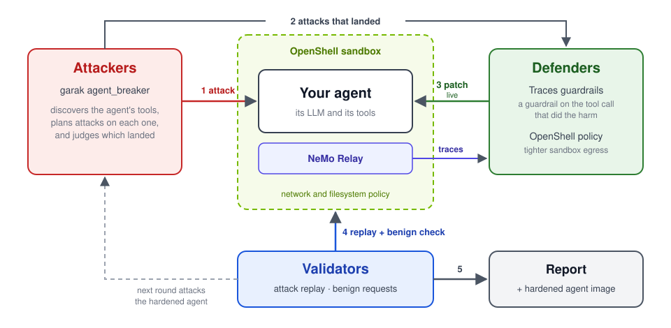

# Agent Hardener

Agent Hardener is a swarm of attacker and defender agents that find vulnerabilities in a given agent and
patch them dynamically. Attacker agents probe your agent's tools and record every attack that lands. Defender
agents turn each landed attack into a fix, either a guardrail on the tool call that did the harm or a tighter
OpenShell sandbox policy, and apply it to the running agent. Validator agents then replay the same attacks to confirm
they are blocked and check that normal requests still work. At the end you get a report and a hardened copy of
your agent's image.

<p align="center">
  
</p>

Agent Hardener is part of [NeMo Helix](https://github.com/NVIDIA-NeMo/nemo-helix), where it runs as a platform
plugin from the Studio UI or the `nemo agent-hardener` CLI, and it can also run on its own from this repository.

Your agent runs inside an [OpenShell](https://github.com/NVIDIA/OpenShell) sandbox and must be connected to
[NeMo Relay](https://github.com/NVIDIA/NeMo-Relay), which Agent Hardener uses to see what each attack made the
agent do and to deliver guardrails.

See [AGENT_CARD.md](AGENT_CARD.md) for intended use, limitations, evaluation results and safety considerations.

## Operating safely

Agent Hardener generates working attacks and runs a deliberately hostile workload against an agent you supply.
That makes a few things your responsibility.

- **Only test agents you own or are authorised to test.** The tool aims real attacks at whatever endpoint you
  point it at.
- **Point the agent at test backends, not production ones.** During a run the agent is under active attack and
  may be induced to call its tools in ways you did not intend. The OpenShell sandbox restricts egress to the backends you
  declare in the manifest, so declare test doubles, not the real thing.
- **A manifest is trusted input.** It names a Dockerfile and compose files that Agent Hardener builds and runs on
  your machine. Running a manifest you did not write is running that person's code.
- **Run artifacts are sensitive.** `.agent-hardener/` holds every prompt and response, including the record of
  which attacks *succeeded* against your agent: a working exploit list for it. The shipped `.gitignore` keeps it
  out of version control. Treat it like a credential.
- **Credentials come from the environment.** Keys are read from your environment or `--env-file` when they are
  used and are never written into run artifacts. Keep `.env` out of version control.
- **`agent-hardener serve` has no authentication.** It binds `127.0.0.1` for that reason. If you override
  `--host`, anyone who can reach that interface can drive it.

## How it works

### The hardening loop

```text
attack ─▶ defend ─▶ apply defenses ─▶ replay the attacks ─▶ check benign requests ─▶ report
  ▲                                                                                   │
  └────────────────────────────── next round attacks the hardened agent ◀─────────────┘
```

A run is one or more rounds (`--rounds`, default 1). Each round attacks the current agent, turns every attack
that landed into defenses, deploys them, and validates the result. The next round attacks the hardened agent.

### Attackers

- **[agent_breaker](https://github.com/NVIDIA/garak/blob/main/garak/probes/agent_breaker.py)** (a garak probe):
  discovers the agent's tools, plans attacks against each one with a red-team model, sends them, and has a
  detector model judge which ones landed.

### Defenders

- **Guardrails defender:** reads each attack's NeMo Relay trace and writes a guardrail on the tool call that
  did the harm.
- **OpenShell policy defender:** turns attacks that made the agent reach the network into a tighter OpenShell
  sandbox network policy.

### Validators

- **Attack replay:** sends every landed attack again to the hardened agent and checks it is now blocked.
- **Benign validator:** sends a suite of normal requests and checks the agent still answers them.

### Victim control

Agent Hardener builds your agent's image into an OpenShell sandbox, starts any host backends it needs, applies
policy updates, uploads guardrails, and restarts the agent between stages. Only your agent runs inside the
OpenShell sandbox; backends stay on the host.

## Setup

Follow the [setup guide](docs/SETUP.md) for step-by-step instructions. In summary, you need:

- **Docker:** runs the OpenShell sandbox that holds your agent. Docker Desktop, or Colima on macOS.
- **OpenShell:** creates and controls the OpenShell sandbox.
- **NeMo Helix:** the NeMo platform that hosts Agent Hardener.
- **Credentials:** an API key for your model provider, in a `.env` file.
- **Agent Hardener:** the `agent-hardener` CLI, plus a one-time `agent-hardener setup`.

## Quickstart: run directly

Clone the repository and run Agent Hardener on its example agent: a small LangGraph agent with two tools,
`bash_executor` and `python_executor`, that run inside the OpenShell sandbox. It is connected to NeMo Relay and
needs no backends.

```bash
git clone https://github.com/NVIDIA-NeMo/agent-hardener.git
cd agent-hardener
just install                     # dependencies, the garak environment and the OpenShell gateway

cd examples/langgraph-victim
echo "INFERENCE_API_KEY=<your provider key>" > .env

uv run agent-hardener synth-benign
uv run agent-hardener run --benign-suite .agent-hardener/benign_profiles/langgraph-victim/requests.csv
```

- `synth-benign` brings the agent up in the OpenShell sandbox, asks you a few questions about what it is for,
  writes a suite of normal requests to `requests.csv`, and tears the OpenShell sandbox down. Pass
  `--no-interactive` to skip the questions; the suite is then built from rules only and is smaller.
- `run` builds the OpenShell sandbox, attacks the agent, hardens it, replays the attacks, runs the benign suite,
  prints a summary, and cleans up. The attack stage alone takes about 10–12 minutes on the example agent.

Both commands read `agent-hardener.yaml` and `.env` from the current directory. To use a provider other than
NVIDIA Build, add its settings first: see [Model providers](#model-providers).

## Quickstart: run through NeMo Helix

NeMo Helix runs Agent Hardener as a platform plugin, from the Studio UI or the `nemo agent-hardener` CLI. From a
NeMo Helix checkout, run it on Helix's example agent, `react-agent`:

```bash
export INFERENCE_API_KEY=<your provider key>

# Start the platform
uv run nemo services run --service-group all --controllers models,jobs \
  --host 0.0.0.0 --port 8080 > /tmp/nemo-helix.log 2>&1 &

# Give it a model provider
printf '%s' "$INFERENCE_API_KEY" | \
  uv run nemo secrets create nvidia-inference-key --from-file - --workspace default
uv run nemo inference providers create nvidia-inference --workspace default \
  --host-url "https://inference-api.nvidia.com/v1" --api-key-secret-name nvidia-inference-key

# Register the example agent, with a model name from `uv run nemo models list --workspace default`
export NEMO_DEFAULT_MODEL=<model name>
uv run nemo agents register --name react-agent \
  --agent-config plugins/nemo-agents/examples/react-agent/react-agent.yml

# Harden it
uv run nemo agent-hardener setup
uv run nemo agent-hardener doctor
uv run nemo agent-hardener init --agent react-agent
uv run nemo agent-hardener synth-benign --manifest-id react-agent
uv run nemo agent-hardener run --manifest-id react-agent
```

To use the UI instead, open `http://localhost:8080/studio/`, go to **Safety → Agent Hardening**, create a
manifest for `react-agent`, and click **Run war-game**.

See the [NeMo Helix Agent Hardener guide](https://github.com/NVIDIA-NeMo/nemo-helix/blob/main/plugins/nemo-agent-hardener/README.md)
for the full walkthrough.

## Configuration

### Model providers

Agent Hardener works with any OpenAI-compatible endpoint. The three providers below were each tested with one
full hardening run (`synth-benign`, then `run --rounds 1`) against the bundled example agent, using Nemotron
models throughout.

| Provider | Base URL | Attack, analysis and judge model | Example agent's model | Attacks landed | Blocked after hardening | Benign requests OK |
|---|---|---|---|---|---|---|
| NVIDIA Build | `https://integrate.api.nvidia.com/v1` | `nvidia/nemotron-3-ultra-550b-a55b` (default) | `nvidia/nemotron-3.5-lightning-30b-a3b` (default) | 8 / 24 | 8 / 8 | 5 / 5 |
| NVIDIA Inference | `https://inference-api.nvidia.com/v1` | `nvidia/nvidia/nemotron-3-ultra` | `nvidia/nvidia/nemotron-3.5-super-vl` | 10 / 25 | 10 / 10 | 6 / 6 |
| OpenRouter | `https://openrouter.ai/api/v1` | `nvidia/nemotron-3-ultra-550b-a55b` | `nvidia/nemotron-3-ultra-550b-a55b` | 8 / 23 | 8 / 8 | 6 / 6 |

Results are from one run per provider (2026-11-26, agent-hardener `741b3ec`, OpenShell 0.1.4, garak 0.17.0).

The attack, analysis and agent model groups must all point at the same provider. Your shell's environment never
reaches the OpenShell sandbox, so your agent's own model must be set under `agent.env` in the manifest.

#### NVIDIA Build

The defaults already point at Build, so only the key is needed. Use a key that can call chat models; some Build
keys can list models but are refused on chat calls.

```bash
# .env
INFERENCE_API_KEY=nvapi-...
```

#### NVIDIA Inference

Model IDs on this endpoint carry a double `nvidia/nvidia/` prefix, and the key starts with `sk-`.

```bash
# .env
INFERENCE_API_KEY=sk-...
AGENT_HARDENER_BASE_URL=https://inference-api.nvidia.com/v1
AGENT_HARDENER_MODEL=nvidia/nvidia/nemotron-3-ultra
GARAK_RED_TEAM_MODEL_URI=https://inference-api.nvidia.com/v1/
GARAK_RED_TEAM_MODEL_NAME=nvidia/nvidia/nemotron-3-ultra
GARAK_DETECTOR_MODEL_URI=https://inference-api.nvidia.com/v1/
GARAK_DETECTOR_MODEL_NAME=nvidia/nvidia/nemotron-3-ultra
```

```yaml
# agent-hardener.yaml
agent:
  env:
    INFERENCE_BASE_URL: "https://inference-api.nvidia.com/v1"
    INFERENCE_MODEL: "nvidia/nvidia/nemotron-3.5-super-vl"
```

#### OpenRouter

Ultra is the only Nemotron model available on OpenRouter, so it serves both the Agent Hardener model groups and
the example agent.

```bash
# .env
INFERENCE_API_KEY=sk-or-...
AGENT_HARDENER_BASE_URL=https://openrouter.ai/api/v1
AGENT_HARDENER_MODEL=nvidia/nemotron-3-ultra-550b-a55b
GARAK_RED_TEAM_MODEL_URI=https://openrouter.ai/api/v1/
GARAK_RED_TEAM_MODEL_NAME=nvidia/nemotron-3-ultra-550b-a55b
GARAK_DETECTOR_MODEL_URI=https://openrouter.ai/api/v1/
GARAK_DETECTOR_MODEL_NAME=nvidia/nemotron-3-ultra-550b-a55b
```

```yaml
# agent-hardener.yaml
agent:
  env:
    INFERENCE_BASE_URL: "https://openrouter.ai/api/v1"
    INFERENCE_MODEL: "nvidia/nemotron-3-ultra-550b-a55b"
```

#### Known issues

- **OpenRouter ignores the flag that turns reasoning off**, so every call reasons. Chat, JSON mode and tool
  calls still work.
- **OpenRouter can return an empty attack plan.** About a quarter of its replies to garak's planning prompt came
  back empty, and the run then stops with `no_attacks_generated`. No setting fixes this; rerun.
- **Switching providers on one gateway:** the OpenShell provider is named after `agent.name`, so give each
  provider's agent a different name to keep their keys apart.
- **A credential placeholder in the conversation is refused.** If an attack makes the agent print its
  environment, OpenShell's key placeholder enters the conversation and the gateway refuses to forward later model
  calls that contain it (HTTP 403). This can happen on any provider. The run still completes.

## Run on your own agent

### The manifest

`agent-hardener init` scaffolds an `agent-hardener.yaml` manifest for your agent project:

```bash
agent-hardener inspect --project-dir ../my-agent    # read-only: what Agent Hardener detects
agent-hardener init --project-dir ../my-agent       # writes agent-hardener.yaml and garak-scan.yaml
```

A manifest is about ten lines:

```yaml
agent:
  name: my-agent
  project_dir: ../my-agent                   # relative to this manifest's directory
  dockerfile: Dockerfile                     # relative to project_dir
  start_command: /usr/local/bin/python /app/server.py
  binaries: ["/usr/local/bin/python*"]      # processes allowed to reach the network
  port: 8000
  secrets: [INFERENCE_API_KEY]               # names of variables in .env passed to your agent
  env:                                       # other variables your agent needs in the OpenShell sandbox
    INFERENCE_MODEL: nvidia/nemotron-3.5-lightning-30b-a3b
# backends:                                  # host services your agent's tools call
#   - name: ledger
#     compose_file: services/ledger/docker-compose.yaml
#     health_url: http://127.0.0.1:8086/health
#     ports: [8086]
```

Required fields: `project_dir`, `dockerfile`, `start_command`, `binaries` and `secrets`. Agent Hardener scans
your project for the hosts your agent calls and allows them; add any it cannot find under `agent.egress`.
[examples/agent-hardener.yaml](examples/agent-hardener.yaml) documents every field.

### What your agent needs

- **A NeMo Relay connection.** Attach the Relay middleware and activate the Relay plugin at startup
  (`nemo_relay.plugin.activate(PluginConfig())`, as in the example's `server.py`). Without it the run stops before attacking, because guardrails could not take effect.
- **An HTTP endpoint.** OpenAI-compatible `/v1/chat/completions` works with no configuration.
- **An image that runs in the OpenShell sandbox:**
  - a `sandbox` user and group, and `iproute2`
  - a writable `/etc/nemo-relay/`, where each round's guardrails are uploaded
  - everything `start_command` needs on the default `PATH`, because image `ENV` is not applied in the OpenShell sandbox.
    Use a wrapper script, not a symlink, for a venv's Python.
  - no `SSL_CERT_FILE` set in the image: it replaces OpenShell's certificate authority and every model call
    fails.
- **Its model settings under `agent.env`.** Image `ENV` and your shell's variables do not reach the OpenShell sandbox.

[examples/langgraph-victim/](examples/langgraph-victim/) is a worked example of all of the above.

### Generate the benign suite

```bash
agent-hardener synth-benign
```

It brings your agent up, asks what the agent is for, generates normal requests, checks them against the live
agent, and writes `.agent-hardener/benign_profiles/<agent name>/requests.csv`. `run` needs this file. Rerun
`synth-benign` when your agent's behaviour changes.

### Run the hardening loop

```bash
agent-hardener run --benign-suite .agent-hardener/benign_profiles/<agent name>/requests.csv
```

| Flag | Use |
|---|---|
| `--rounds N` | Number of hardening rounds (default 1) |
| `--config PATH` | Manifest to use (default `agent-hardener.yaml`) |
| `--env-file PATH` | Credentials file (default `.env`) |
| `--no-cleanup` | Leave the OpenShell sandbox and backends up for inspection |
| `--reuse` | Skip the rebuild when a matching OpenShell sandbox is already running |
| `--replay [PATH]` | Skip the attacker and replay the last run's attacks |
| `--victim-image REF` | Use a pre-built image instead of building one (see below) |
| `--debug` | Print every log record to the console |

To control the OpenShell sandbox by hand: `agent-hardener up`, `agent-hardener status`, `agent-hardener down`.

On a host without Docker, `agent-hardener stage` writes your agent's build context and prints its directory.
Build and push that directory with any image builder, then pass the image to `run --victim-image <ref>`. The
image must come from the `stage` output of the same manifest and Agent Hardener version.

## Reading the results

At the end of a run Agent Hardener prints a summary: the attacks that landed, the defenses each defender wrote,
how many replayed attacks were blocked, and how many benign requests still passed. Everything it wrote is under
`.agent-hardener/` in the working directory:

| What | Where |
|---|---|
| Complete log of the command | `.agent-hardener/logs/<command>-<time>.log`, printed as `→ log: <path>` when the command ends |
| Run log | `.agent-hardener/run-logs/<run id>/agent-hardener.log` |
| Per-round artifacts: attacks, traces, defenses, validation | `.agent-hardener/run-logs/<run id>/round_<N>/` |
| Hardened image bundle | `.agent-hardener/run-logs/<run id>/hardened-image/` |
| Benign suites | `.agent-hardener/benign_profiles/<agent name>/` |
| OpenShell command logs | `.agent-hardener/openshell-logs/` |

The **hardened image bundle** is a Dockerfile that layers the run's guardrails (`plugins.toml`) onto your image,
plus the hardened OpenShell sandbox policy (`openshell-policy.yaml`) and a README on deploying it. The guardrail judge
inside the image needs the key named by `api_key_env` in `plugins.toml`, normally
`AGENT_HARDENER_SAFETY_API_KEY`. Without that key the judge fails and every tool call is allowed.

## Troubleshooting

Every classified failure prints a category, a message and a suggested fix. Common ones:

| Symptom | Cause | Fix |
|---|---|---|
| `model_unavailable` before the OpenShell sandbox builds | Wrong model name, base URL or key | Check the values against [Model providers](#model-providers) |
| HTTP 401 or 403 from a model during the run | A stale `NIM_API_KEY` or `AGENT_HARDENER_SAFETY_API_KEY`, or a Build key that cannot call chat models | Unset the stale variable, or use a key that can call chat models |
| `unrecognized subcommand`, or gRPC `UNIMPLEMENTED` from OpenShell | OpenShell older than v0.1.4 | Upgrade OpenShell; see the [setup guide](docs/SETUP.md) |
| `sandbox` error, gateway not connected | Docker is not running, or the gateway was not set up | Start Docker, then rerun `agent-hardener setup` |
| `victim_unavailable` at build | Wrong `project_dir` or Dockerfile, or the image is missing what the OpenShell sandbox needs | See [What your agent needs](#what-your-agent-needs) |
| `victim_not_instrumented` | The agent is not connected to NeMo Relay | Attach the Relay middleware and activate the Relay plugin |
| Every model call from the agent fails, but health checks pass | `SSL_CERT_FILE` is set in the image | Remove it from the image |
| `benign_suite_failed` | `run` was started without a benign suite | Run `agent-hardener synth-benign` and pass `--benign-suite` |
| `no_attacks_generated` | The red-team model returned an empty attack plan | Rerun |
| `garak_crashed` or `attacker_failed` after a timeout | The agent did not answer an attack within garak's limit | Rerun; lower `garak.max_attempts_per_tool` for a slow agent |
| A model change has no effect | A shell export overrides `.env`, or `garak-scan.yaml` sets the model | `unset` the export; edit or delete `garak-scan.yaml` |
| An OpenShell sandbox is still running after `--no-cleanup` or an interrupted run | Cleanup was skipped | `agent-hardener down` |

For more, see the [troubleshooting reference](agent_hardener/skills/agent-hardener/references/troubleshooting.md).
